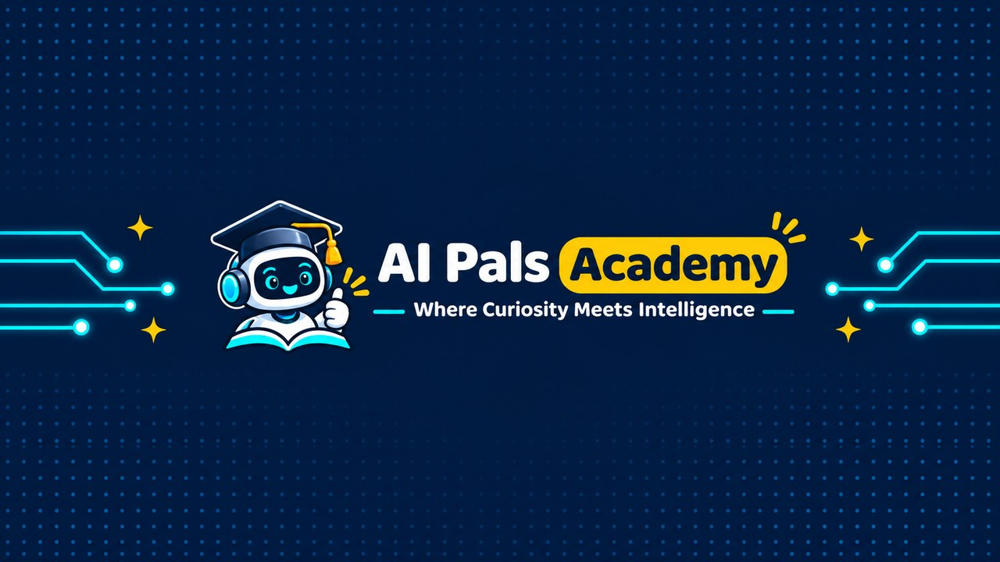

<p align="center">
  
</p>

# AI Pals Academy — Labs

Free, hands-on workbooks that go with the **AI Pals Academy** YouTube videos.
Each workbook teaches the ideas first, with diagrams, and then walks you through practices step by step.

## Workbooks

| # | Topic | What you'll learn | Files |
|---|---|---|---|
| WB01 | **Agents & Subagents** | Build an AI team in Claude desktop: parallel and sequential agents, CLAUDE.md, skills | [Open folder](Agents-and-Subagents/) |
| WB02 | **Claude Projects Made Simple** | Plan, organize and automate big work with Claude Projects: threads, files, memory, connectors, scheduled tasks | [Open folder](Claude-Projects-Made-Simple/) |

*More workbooks coming soon.*

## How to use a workbook

1. Open the topic's folder from the table above.
2. Download the **PDF** (the workbook) and the **.zip** (the starter files).
3. Watch the matching video, then follow the PDF one practice at a time.

To download a single file: click it, then click the **download** button (↓) at the top right of the file view.

## Folder layout

Every topic follows the same layout:

```
<Topic-Name>/
├─ README.md          ← start here
├─ WBxx-<Topic>.pdf   ← the workbook
├─ <starter>.zip      ← starter files, one-click download
└─ <starter>/         ← the same files, to browse online
```

## Licence

Free for personal learning and teaching. © AI Pals Academy, licensed under [CC BY-NC 4.0](LICENSE).
Please credit **AI Pals Academy** if you share it, and don't re-sell or re-publish it commercially.
The AI Pals Academy name, logo and mascot may not be reused without permission.
